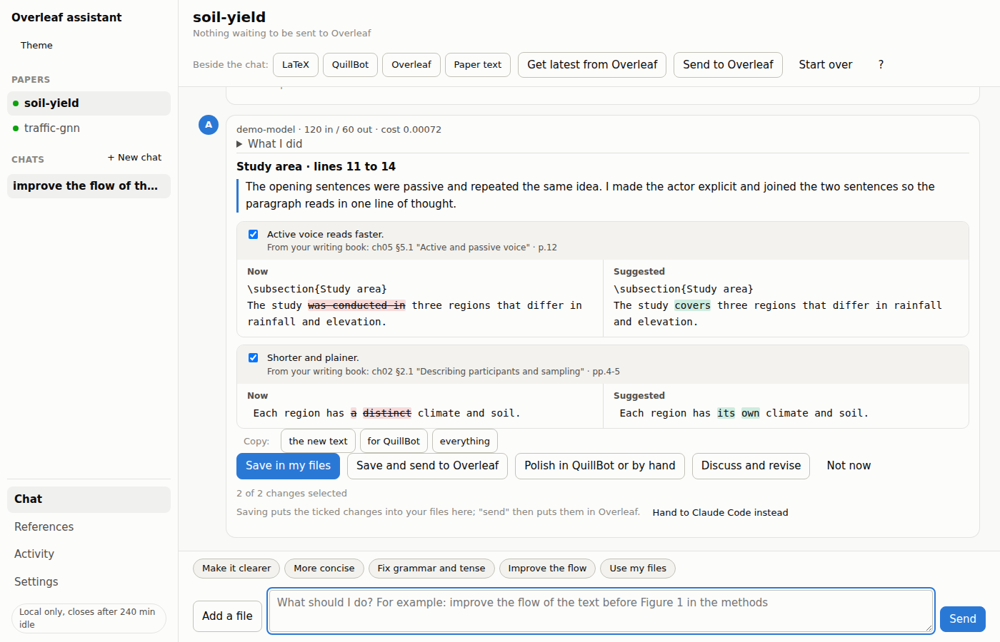

# research-overleaf-wc

**A writing assistant for researchers who write in LaTeX on Overleaf.** It runs on your own computer: you pick a paper, say what you want in plain words, and it improves your text, writes new passages from
your own results, cites your own reading, keeps your bibliography in order and sends the changes to Overleaf. It follows the advice of a writing handbook that *you* provide, uses ChatGPT as the editor,
and never saves or sends anything you have not approved.



*(The pictures in this document were taken with a made-up paper and a stand-in model.)*

## What you can do with it

- **Improve what you wrote.** *"Improve the flow of the text before Figure 1 in the methods"*, *"fix the grammar in the introduction"*, *"make the abstract shorter"*. It finds the right part of your paper, adds the
  few pages of your writing book that apply, and asks OpenAI for a better version with an explanation. Citations, formulas and numbers are swapped for tags before anything leaves your computer, and an answer that
  changes any of them is thrown away. You keep or set aside each change.
- **Write the Results and the Discussion from your analysis.** Point it to the folder with your code, tables, logs and figures. *"Write the results from my analysis"* produces paragraphs in which every number comes from your
  files and every statement says which file it rests on. ([Details](docs/guide.md#writing-new-text-from-your-sources))
- **Use your own reading.** Point it to the folder where you keep books and articles (subfolders are fine). It reads them once, on your computer, and can answer *"what do my articles say about irrigation timing?"*
  with the page, cite them in your text, and add them to your bibliography. ([Details](docs/guide.md#your-reading-the-literature-library))
- **Find references on the internet and cite them.** *"Find references about armed conflict and pipeline attacks in Colombia"* searches the web and two open scholarly indexes, shows each paper with its abstract and DOI, and adds
  the ones you tick to your bibliography; a suggestion can then be written again with them, citing them from their abstracts. ([Details](docs/guide.md#finding-references-on-the-internet-and-citing-them))
- **Peer review.** *"Peer review my paper"* scores it against a rubric and lists the problems; **Fix this** turns a comment into an ordinary suggestion. Nothing changes by itself.
- **References.** Paste a DOI: it goes into your `.bib`, your Mendeley group and Overleaf, and you get the `\cite{...}` to use. (Also from your phone, through a Telegram bot.)
- **See your paper.** Your LaTeX source and the compiled PDF side by side, on your computer; QuillBot and Overleaf in panes next to the chat for the tone pass.
- **From Claude Code too.** The same tools are available to [Claude Code](https://claude.com/claude-code) in your terminal: sync with Overleaf, edit exact passages, manage references, search the library.

## How it works

1. **Pick a paper.** The app keeps private notes about each paper; one paper never sees another's.
2. **Say what you want**, in your own words. It works out which part of your paper you mean and finds the advice that applies. You never have to look at the book or at how it was cut up.
3. **OpenAI answers** with a better text and why, or with new text and the sources it rests on. Everything it may say is checked first: protected LaTeX intact, no number that is in none of your files, no invented citation.
4. **You decide.** Keep or set aside each change; adjust the tone in QuillBot if you like; the app checks that no citation or number was lost.
5. **Save, then send.** *Save in my files*, or *Save and send to Overleaf* in one press.

## What you need

- A Mac or Linux computer with **Docker** (Docker Desktop, or Docker Engine) for the app. Without Docker you can run it with Python 3 and git (`python3 scripts/ui/server.py`); the PDF features then need `poppler`, and the LaTeX pane needs your own TeX Live or MacTeX.
- An **OpenAI API key** (you pay OpenAI for what you ask; each request shows its size first). Any model your account can use.
- An Overleaf project with **Git integration**, which is a paid Overleaf feature, and a Git authentication token from your Overleaf account settings.
- A **writing handbook as a PDF with selectable text** that you are allowed to use (it stays on your computer and is never part of this repository). Optional but it is what makes the advice yours.
- Optional: a Mendeley account (reference manager), a Telegram bot (references from your phone), the `academic-paper` Claude skill (installed under `~/.claude/skills/`) for the peer-review rubric.

## Quick start

```bash
git clone https://github.com/OphirIAn-CO/research-overleaf-wc
cd research-overleaf-wc
./install.sh ui      # builds the Docker image once: several minutes, about 1.5 GB (it includes LaTeX and the built-in browser)
./ui.sh up           # starts the app and opens it in your browser; ./ui.sh down stops it (it also stops itself when idle)
```

Then, **in the app, under Settings** (nothing to edit by hand):

1. **OpenAI**: paste your key and the model name, press *Test*.
2. **Overleaf**: paste your Git token, press *Test*.
3. **Papers**: clone your Overleaf project (Overleaf: Menu, Git) into a folder, share that folder with the app once (`./ui.sh folders add ~/path/to/your/papers`, then `./ui.sh down && ./ui.sh up`), and press *Add* next to it.
4. **Writing book**: press *Choose the book PDF* and pick the file (a PDF with selectable text). The app copies it into its private folder and reads it; nothing to find or move by hand.
5. Optional: **Literature library** and **Code and results** (point them at your folders; in Docker share them read-only: `./ui.sh folders add --read-only ~/Documents/Literature`).

Then open the **Chat** and ask for something. The [guide](docs/guide.md) explains every part.

### Use it from Claude Code

```bash
./install.sh                                                        # creates ~/.config/overleaf-skill/ and registers the tools with Claude Code
python3 scripts/common.py add /path/to/your/paper --group "Your Mendeley group"      # --group is optional; repeat for every paper
python3 scripts/common.py doctor                                    # checks everything is healthy
```

For Claude Code to find the instructions, clone this repository into `~/.claude/skills/research-overleaf-wc` (or link it there). Then ask Claude Code to *"sync my paper"*, *"add a citation for X to the introduction"*,
*"review my draft"*, or *"what does my library say about X"*. [`SKILL.md`](SKILL.md) is the full instruction set it follows.

## Your data, and what leaves your computer

- **Nothing runs in the cloud except what you ask for.** The app listens on `127.0.0.1` only, needs a fresh access token every time you start it, refuses requests from other websites, loads nothing from the internet, runs as you
  with a read-only filesystem, sees only the folders you chose, and closes itself when idle.
- **OpenAI** gets, for a request you made: the passage (with citations, formulas and headings masked), a short card about the paper, a few pages of your book, and, only when the request uses them, the listed parts of your
  files and library and up to four shrunk pictures of your figures. The request shows what goes out ("What goes out", "Show the exact text") and you can turn on *Ask me before anything is sent*. Never another paper, never your keys.
- **Secrets** (OpenAI key, Overleaf token, saved sign-ins) are in `~/.config/overleaf-skill/`, outside this repository and your papers, readable only by you. Saved site passwords there are **not encrypted**.
- **QuillBot** is a third party: only what you paste there leaves your computer.
- **Your files, library and analysis are only read**, never changed or sent to Overleaf unless you add a file to the paper yourself.
- The activity log holds counts, ids and timings, never your text.

More in the guide: [Safety](docs/guide.md#safety), [Where things live](docs/guide.md#where-things-live).

## When something goes wrong

| Problem | Fix |
|---|---|
| `ui.sh up` says Docker is not running | Start Docker Desktop, wait until it says it is running, try again. |
| "This app isn't signed in to Overleaf yet" | Paste your Git token in **Settings > Overleaf** and press *Test*. |
| The app does not list a paper | Share the folder that holds it (`./ui.sh folders add <folder>`), then `./ui.sh down && ./ui.sh up`. |
| Push rejected / "Overleaf has newer changes" | Press *Get the latest from Overleaf, then send again*; if the same lines changed on both sides the app shows each place and lets you choose. |
| The key was rejected, or the model was not found | **Settings > OpenAI > Test** says which one. |
| A folder shows "I cannot see this folder" | In Docker, share it read-only: `./ui.sh folders add --read-only <folder>`, then restart the app. |
| The book gives odd advice | **Settings > Advanced > Book library > Book check** shows which pages each part would use. A scanned (image-only) PDF needs OCR first. |

The [guide](docs/guide.md#troubleshooting) has the long list.

## Development

```bash
python3 -m unittest discover -s tests -t .     # everything, offline: a fake OpenAI and a small test PDF stand in for the real ones
python3 tests/e2e/demo_server.py --port 8799   # a demo of the app with a made-up paper, for the browser tests (tests/e2e/*.js, Playwright) and for taking the pictures in docs/
```

The code is plain Python 3 (standard library only) and vanilla JavaScript, with no build step. `scripts/writing_core/` is the engine (retrieval, checking, drafting), `scripts/ui/` the web app,
`SKILL.md` the instructions for Claude Code. The OpenAI client has been tested against a local fake of the API, not the live service: do a first real request on a throwaway paragraph and read the preview before
trusting it with more. Not affiliated with Overleaf, OpenAI, Mendeley, QuillBot or Anthropic.

## License

[MIT](LICENSE).
