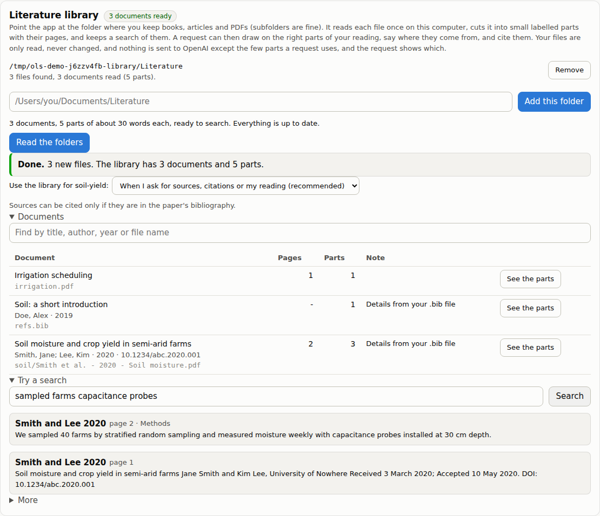

# The guide

Everything the app can do, in the order you meet it. The short version is in the [README](../README.md).

Contents: [Setting up the services](#setting-up-the-services) · [Everyday use](#everyday-use) · [Your reading: the literature library](#your-reading-the-literature-library) ·
[Your analysis: code and results](#your-analysis-code-and-results) · [Writing new text from your sources](#writing-new-text-from-your-sources) · [Your files and writing material](#your-files-and-writing-material) ·
[The LaTeX pane](#the-latex-pane-your-papers-source-and-its-pdf-on-this-computer) · [QuillBot and Overleaf inside the app](#quillbot-and-overleaf-inside-the-app-the-built-in-browser) ·
[Sending to Overleaf](#sending-to-overleaf-and-why-it-sometimes-says-overleaf-has-newer-changes) · [Where things live](#where-things-live) · [Safety](#safety) · [Troubleshooting](#troubleshooting)

## Setting up the services

Install the app first (see the README: `./install.sh ui`, then `./ui.sh up`). Everything below is done **inside the app, in Settings**, except where a terminal is named.

```bash
./install.sh ui      # builds the Docker image once (several minutes, about 1.5 GB: it includes LaTeX and the built-in browser)
./ui.sh up           # starts it and opens your browser
./ui.sh down         # stops it (it also stops itself when idle)
```

1. **OpenAI**: paste your API key and the model name you want to use; press **Test** (it is a read-only check, no cost).
2. **Overleaf**: paste your Overleaf Git token (Overleaf: Account Settings, Git Integration) so the app can get the latest and
   send your changes; press **Test**.
3. **Writing book**: put the PDF (selectable text) in `~/.config/overleaf-skill/inbox/` and press **Prepare the book**. It is read
   once. Optionally press **See the cost**, then **Make the summaries once**: a one-time step that makes every later request
   cheaper and sharper (it sends the book text to OpenAI once, shows the estimate first, and can resume).
4. **Text-cleaning service** (optional): the address of a local service that post-processes new text before it is saved (for example one that removes
   hidden characters or fixes typography). Leave it empty to save text exactly as you approved it; the card then says so. The service must answer
   `POST /inspect` with `{"text": ...}` (any JSON object) and `POST /clean` with `{"text": ..., "layer": "A"}` (JSON with the cleaned string under `text`); see
   `scripts/writing_core/watermark.py`. When it is set, every save goes through it first and a failing service blocks saving.
5. **Papers**: your registered papers are in the sidebar. To add more from the app, share the folder that holds your Overleaf
   clones once (`ui.sh folders add ~/path/to/folder`, then `ui.sh down` and `ui.sh up`); the app lists the clones in it with an
   **Add** button. `common.py add <path> --group "Mendeley group"` still works.
6. **Mendeley**: signing in needs a browser, so run `python3 scripts/mendeley_sync.py authorize` once (Settings shows the exact
   command). Link a paper to its group on the References page.
7. **Literature library**: the folder where you keep your books and articles, read once so the app can search and cite them ([below](#your-reading-the-literature-library)).
8. **Code and results**: the folder where your analysis lives, so the Results and the Discussion can be written from what it produced ([below](#your-analysis-code-and-results)).

Then just talk to it. The pages are **Chat**, **References**, **Activity** and **Settings**; the papers and your chats are in the sidebar.
The chat uses the width of your window. In an answer the explanation, questions and warnings sit on top (side by side when there is room), and the before/after comparison below them uses the full width of the card, **Now** and **Suggested** side by side; only a card narrower than about 520 pixels stacks them. The comparison's text is sized to the card, not the window, so it stays readable with a pane open beside the chat.

### Mendeley (optional) and Telegram (optional)

**Mendeley.** Do this on every computer that should talk to Mendeley (each one signs in by itself; do not copy the token file between computers).

1. Create an app at [dev.mendeley.com](https://dev.mendeley.com) with redirect
   URI `https://localhost/callback`.
2. Save its credentials in `~/.config/overleaf-skill/mendeley_credentials.json`:
   ```json
   {"client_id": "...", "client_secret": "..."}
   ```
3. Run `python3 scripts/mendeley_sync.py authorize`
   and follow the prompts (the browser page that fails to load at the end is
   expected; copy its address back into the terminal). Paste **the address the browser ends up on** (it starts with `https://localhost/callback?code=`),
   not the first link, and do it right away: the code works once and expires within a minute or two. If Mendeley says `invalid_grant` ("Invalid access code"),
   run the command again and use the new link; never reuse an old code.

*A coauthor on another computer.* Everyone should use **their own Overleaf Git token** (Overleaf: Account Settings, Git Integration) and sign in to Mendeley on their own computer.
Best is that they use their own Mendeley account (you invite them to your Mendeley group) and their own Mendeley app, so that nobody shares a login or a client secret.
If you do share an app, the `client_id` and `client_secret` in `mendeley_credentials.json` are a secret: send them privately, never through git.

**Telegram.**

1. In Telegram, message **@BotFather**, send `/newbot`, and copy the token.
2. Create `~/.config/overleaf-skill/telegram.json`:
   ```json
   {"token": "<your token>", "allowed_chat_ids": [], "push": true}
   ```
3. Start the bot: `python3 scripts/doi_bot.py run`
4. Send your bot any message. It replies with your chat id. Put that number in
   `allowed_chat_ids`, then restart the bot. Until you do, it refuses everyone.
5. Keep it running after a reboot (macOS): `install.sh bot-service`

**Using it:** send a DOI or a `doi.org` link. The bot adds it to the paper you
last worked on in Claude Code, and every reply says where it went:

```
[my_paper @6aa33c64 -> My Mendeley group]
Added \cite{Alves2018Brazilian}
Pushed to Overleaf.
```

If you haven't touched that paper for a while, the bot asks which paper first.
`/paper` switches papers, `/status` shows the current target.

## Everyday use

### Answering the model's questions and changing a suggestion

 When OpenAI asks a question ("What specific criteria were used?"), the question has a box under it for your reply, and
the suggestion has an **Answer and revise** button (**Discuss and revise** when there was no question). It opens a small panel with the request as it was understood (for a
reviewer's comment: the comment itself, which you can reword) and a box for anything to add or change ("keep it to two sentences"). **Make a new suggestion** asks OpenAI again for
the same place with your replies, which it uses as given: it adds nothing beyond them, and the numbers and names in them are not treated as invented (everything else is checked as
before). The new suggestion replaces the old one, which can then no longer be saved by mistake, and the reviewer's comment it belongs to follows the new one in the panel.
It costs about as much as the first request. If the new try fails or finds nothing to change, the first suggestion stays open.

### Going through a peer review

 The review lists its comments; **Fix this** on one turns it into an ordinary suggestion. While a review with
two or more comments still has open ones, a **Reviewer comments** panel stays above the message box with all of them, so after every decision you
see what is left without scrolling back. Each comment shows where it stands, with a colour and a mark: *Working on it*, *Suggestion ready: your
decision*, *Completed - saved here, not in Overleaf yet*, *Completed - sent to Overleaf*, *Set aside* (you pressed Not now), *OpenAI would change
nothing here*, *Skipped* (you pressed Skip: this comment needs no change; **Bring it back** undoes it) or *Could not finish* (**Try again**).
**Fix the next one** takes the next open comment. When the last comment is handled the panel goes away and the chat says so ("All 7 reviewer
comments are handled ... Let's continue. What would you like to work on next?"), with a button to send what was saved but not sent yet. The
review itself stays in the conversation with the final status of each comment, folded away.

### What the chat remembers, and starting again

 Very little. A request goes to OpenAI on its own: the earlier messages of a chat are *not* sent. Inside a chat the
only memory is the place of your last request, so "make it shorter" means the same passage. For the paper, in every chat, two things carry over: the notes about it
(key terms, tense, notation; **Settings > Advanced > Paper index**) and a short style note built from which suggestions you kept or set aside. To start again:
**Start over** (header, or in the **?** panel) empties the current chat and keeps it in the same place; **+ New chat** (sidebar) opens a second, empty one and keeps
the old; **Delete this chat** and **Rename** are in the **?** panel; **Forget my past decisions** (also there, only when something was learned) erases the style note.
None of these touch your paper or the suggestions already saved in your files. **Which chat belongs to which paper:** each chat is a small file inside its own paper's folder (`<paper>/.overleaf-skill/chats/`, git-ignored, never sent to Overleaf), so the sidebar lists exactly the chats of the paper you selected, a chat id from another paper opens that paper's own chat and never this one, and moving or re-cloning a paper folder takes its chats along only if you copy `.overleaf-skill/` with it.

## Your reading: the literature library



Point the app at the folder where you keep books, articles and PDFs (**Settings > Literature library**). Subfolders are read too. Word, text, Markdown, HTML and `.bib` files are read as well.

- **Read once, on this computer.** Press **Read the folders**. Each file is cut into small labelled parts (about 350 tokens, with the page it came from and the heading above it). A first reading takes about a second
  per article; afterwards only new or changed files are read again (**Forget it all and read again** starts over). Reference lists of articles are left out. Scanned PDFs with no text are listed
  with a note. Your files are only read, never changed, and nothing is sent anywhere by reading.
- **Titles, authors and years** come from the PDF's text, then from file names like `Smith et al. - 2020 - Soil moisture.pdf` (the Zotero and Mendeley style), and best of all from a `.bib` file in the same folders:
  a document that matches one of its entries (by DOI, or by an almost identical title) takes its details, and the entry is not listed twice. The list says where each document's details came from.
- **Search it from the chat.** Ask a question about your reading and you get the best parts, with the document, the page and how to cite it, found on your computer (nothing goes to OpenAI):
  *"what do my articles say about well data curation?"*, *"search my library for stratified sampling"*. A part whose document is already in the paper's bibliography shows its `\cite{key}`.
  One that is not has **Add to my bibliography**: it copies the entry from your `.bib`, or adds the document by its DOI the usual way (bibliography, Mendeley group, Overleaf).
- **Use it in a request.** A request that asks for sources, citations or your reading ("support the sampling statement with my library", "add citations to the introduction") sends the few best parts to the model
  with it. Each source the paper's bibliography already has comes with a tag the model may write to cite it; the app turns the tag into the real `\citep{key}` (or whatever command the paper uses most).
  Any other citation is refused, and a source that is not in the bibliography can inform the wording but is never cited. Per paper you can set the library to *when I ask* (default), *every request* or *never*.
  The request card lists the parts that go out; the answer lists the citations it adds.
- **From the terminal and Claude Code.** `writing.py library --add PATH --index`, `--search "text" [--paper NAME]`, and the `library_query` tool.
- **In Docker** the app sees only the folders you share with it: `./ui.sh folders add --read-only ~/Documents/Literature`, then `./ui.sh down && ./ui.sh up`. Folders shared that way are offered as buttons under the folder box.

## Your analysis: code and results


Give the paper the folder where your analysis lives (**Settings > Code and results**), so that the Results and the Discussion can be written from what the analysis really produced.

- **What is read:** scripts and notebooks (Python, R, MATLAB, Julia, SQL, shell; a notebook's text output but not its embedded pictures), tables and numbers (CSV, TSV, JSON, YAML, LaTeX tables the code wrote), logs, notes, and **figures** (PNG, JPG, GIF, WEBP).
  Subfolders are read; hidden folders, build folders, secrets (`.env`, keys, names containing `password` or `token`) and links are never read. Nothing is changed. The card lists every file the app can see, by kind, with **See the parts**.
- **When a request uses it.** In the default mode, a request that is about your results, figures or code ("explain my results", "what do the figures show", "describe the results from my code") brings the right parts:
  the numbers and tables first, the code that produced them, and the figures. An ordinary edit ("improve the flow of the results") does not. Set it per paper to *every request* or *never*.
  The request card says how many parts and pictures go out, and **What goes out** lists them.
- **Figures go to OpenAI as pictures** (at most 4 per request, shrunk to 1024 pixels on the long side, only when the request needs them). They are used to describe what a plot shows: a trend, an order, groups,
  an outlier. The model is told never to read an exact value off a picture, and a number that is in no text part of your files is refused like any invented number. If the model you use takes no pictures, the app
  asks again without them and says so.
- **Numbers.** A number that stands in the parts that went with the request is accepted and pointed out in the answer ("Numbers that came from your files: 0.412. Check them against the source"); one found nowhere is refused.
- **In Docker**, share the folder read-only first: `./ui.sh folders add --read-only ~/code/analysis`, then `./ui.sh down && ./ui.sh up`. Claude Code in your terminal needs no sharing:
  `writing.py settings --paper NAME --link-analysis PATH` links a folder the same way.

## Writing new text from your sources


Asking to *write* something (not to improve what is there) is understood as a request for new text:
*"write the results from my analysis"*, *"draft the discussion of these results"*, *"explain the results in the discussion"*, *"add a paragraph about the sampling to the methods"*.

1. **Where it goes.** At the end of the part you named (or the start, if you say "at the beginning of the results"), or before or after a figure or table ("after Table 1"). The plan says exactly where
   ("at the end of the results, after line 34 of main.tex"). If the paper has no such section yet, the app says so and asks you to add the heading in Overleaf first. Text that is already there is never changed.
2. **What it rests on.** The code output, tables, logs and figures of your analysis, the notes and reports in the folders you chose for the paper, the parts of your library that match the paper's topic (when you
   ask for them), the few pages of your writing book about that part of a paper, and the text just before and after the place. The plan lists them before anything is sent.
3. **What the model may say.** Only what those sources state. Every number must be in them (the same check as for an edit); a figure or table of your paper can be mentioned only through a tag that the app turns into
   its `\ref{...}`; a source of your library can be cited only through its tag, and only if your bibliography has it; no LaTeX, headings or lists; no dashes. When something needed is missing, the model leaves it out and asks.
4. **What you get.** A suggestion with one change per paragraph (**Now: nothing here yet**, **Suggested**: the paragraph), so you can keep some and leave the rest. Each paragraph says which file and rows or pages it rests on,
   and **What each statement rests on** lists every statement with its source. Numbers that are new to the paper are pointed out so you can check them against the source.
5. **Questions.** If the model needed something the sources do not hold ("how many farms were held out?"), the question has a box for your reply; **Answer and revise** writes it again for the same place with your
   answer, which it may use as given. The new suggestion replaces the old.
6. **Saving** puts the text between the two lines it was written for, with a blank line each side, exactly like any other suggestion (**Save in my files**, **Save and send to Overleaf**, or polish it in QuillBot first).
   If either of those two lines changed since the draft was written (for example after you got the latest from Overleaf), nothing is written and you are asked to write it again.

## Your files and writing material

Everything else you want the text to draw on goes in **Settings > Your files and writing material** (or press **Add a file** next to the message box, or drop files on the chat).

- **Add a file:** an article you cite (PDF or Word), a table of results (CSV or TSV), notes (text, Markdown), JSON, a notebook, or code. Pictures are kept but not read here (pictures of *your analysis* are read in the Code and results folder). Excel files: save as CSV first.
  The file is saved in the `references/` folder of your paper, committed on its own (whatever else is waiting stays waiting) and sent to Overleaf, where it shows in the file list. Switch the sending off on the card to keep files here
  until your next send. A second file with the same name never replaces the first (it becomes `name (2).pdf`); passwords and keys are refused; 25 MB per file.
- **Add a folder of material:** a folder (with subfolders) of notes, interview transcripts, reports and articles (PDF or Word) that live outside your Overleaf project. They stay where they are and are only read.
  When you ask for new text to be written, this material is part of what it rests on. In Docker, share the folder first with `./ui.sh folders add --read-only <folder>`.
- **Split into parts.** Each file is cut into small labelled parts of about 350 tokens: a PDF by page and heading (the reference list is left out), a table into a summary (rows, columns, min/max/mean of each numeric column) plus blocks
  of 25 rows, code at its functions, Markdown and Word by heading, a notebook by cell. **See the parts** lists them with where each came from ("pages 3 to 4 · Methods", "rows 26 to 50").
- **When a request uses them.** Never silently. By default a request uses your files when it names one (`rewrite the results using results.csv`) or talks about them ("based on my data", "check it against my files", the
  **Use my files** chip). Everyday words do not count: a file called `results.csv` is not named by "improve the results". You can set it to *every request* or *never* per paper. Only the few best parts go (about 1,800 tokens).
- **Claude Code in your terminal** does not need Docker or sharing: it reads any folder you point it at, through the same parts (`paper_query` with `kind: "source"` or `"project"`).
  `writing.py settings --paper NAME --link-folder PATH` links a folder of material; `writing.py files` lists what is readable.

## The panes next to the chat

### The LaTeX pane: your paper's source and its PDF, on this computer

 Press **LaTeX** above the chat. On the left is the
paper's source (`.tex` and `.bib`, a file menu at the top), coloured, with line numbers; on the right is the PDF made from it, drawn page
by page and sharp at any zoom. Nothing is sent anywhere to make it: the paper is compiled by `latexmk` on your computer (in the Docker
image, or with your own MacTeX/TeX Live when you run the app without Docker), and the PDF and the other files LaTeX writes stay out of
what is sent to Overleaf.
- **Edit and compile.** Type in the source. A moment after you stop, it is saved and compiled (**Auto** switches that off; **Recompile**
  or Cmd/Ctrl + Enter does it at once, Cmd/Ctrl + S saves). Errors are listed in words with their file and line; click one to go there
  (the line is marked red). Undefined citations and references, and missing packages, are listed too. The bibliography runs by itself.
- **The assistant's changes show up in the source.** When it saves a suggestion (or you get the latest from Overleaf), the file that
  changed is shown, the changed lines are highlighted for a few seconds, and the PDF is made again. A green mark in the margin shows
  every line changed here since the last send, i.e. what **Send to Overleaf** will put into Overleaf. Sending itself is unchanged.
- **Source and PDF lead to each other (SyncTeX).** **Show in PDF**, or Cmd/Ctrl + click a line, finds the line in the PDF; double-click
  the PDF to go to its source line. **Source / Both / PDF** chooses what to show; the pane stacks the two when it is narrow. **-**, **+**,
  **Fit**, the page arrows and **Download** work on the PDF.
- **Safe by design.** A file you are editing is never overwritten behind your back: if the assistant saved a suggestion to the same file
  meanwhile, you are asked whether to load the new version or keep yours. Only the paper's own text files can be opened. The compiler runs
  without shell access (`-no-shell-escape`), may not write outside the paper, and is stopped after three minutes
  (`OLS_TEX_TIMEOUT` seconds) with everything it started.
- **No LaTeX on the computer?** The source still shows and can be edited; the pane says what to install (MacTeX, or rebuild the Docker
  image with `./ui.sh build`; `OLS_WITH_LATEX=0 ./ui.sh build` leaves LaTeX out to save about 1 GB). The Overleaf pane stays available.

### QuillBot and Overleaf inside the app (the built-in browser)

 Press **QuillBot**, **Overleaf** or **Paper text** above the chat and the
page opens in the side area. QuillBot and Overleaf refuse to be shown inside another page, so the app starts a real browser (Chromium) in
its own Docker container and shows you what it sees; your mouse and keyboard are passed to it, so it works like a browser tab inside the app.
You sign in once and it stays signed in (the sign-in is kept in `~/.config/overleaf-skill/browser/`; delete that folder to sign out).

- **Sign in:** type your email and password in the page as usual, or save them once in **Settings > Sign-in for QuillBot and Overleaf**
  and press **Fill my sign-in** in the pane. The app types them into the form, checks the page kept them (and tries two other ways if
  it did not), and tells you what happened; you press the site's own Sign in button, so a code or a "not a robot" check stays with you.
  Saved details are in `~/.config/overleaf-skill/sites.json` (`{"quillbot": {"email": "...", "password": "..."}, "overleaf": {...}}`),
  readable only by you and **not encrypted**; the app never shows a saved password again. Google, Apple or university sign-in cannot be
  filled (and Google refuses embedded browsers): for these two sites use an email and password (Overleaf: Account settings, set a
  password; QuillBot: "Forgot password" lets you set one).
- **"Verify you are human" checks.** QuillBot (Cloudflare) and Overleaf (reCAPTCHA) check visitors, and a browser that a program drives
  carries marks those checks can see. So the built-in browser comes in two kinds. **Overleaf** uses a scripted one (it passes). **QuillBot**
  uses an *ordinary* Chromium window on a virtual screen, started with a normal command line and no automation at all: the app takes a
  picture of that screen and passes your mouse and keyboard on as keyboard and mouse events, the way a remote-desktop viewer does. You will
  see the browser's own tab strip and address bar inside the pane. Its address bar works, but it can only open public websites. It is
  Linux Chromium on your own internet connection, not your Mac's Chrome, so a site can still decide not to trust it; nothing here tries to
  solve or get around a check. When a pane shows one, a note appears above it: click the checkbox in the picture, and if it keeps coming
  back press **Open QuillBot in a window instead**. That sends the site to a window of your own browser, which passes these checks, and
  remembers it (**Settings > QuillBot and Overleaf inside the app**, "Use the built-in browser for ..."; you can switch it back there).
- **Layout:** one pane uses the whole side area; **Both at once** (strip at the top of the area) stacks QuillBot above Overleaf; **Wider**
  gives the area more room; drag its left edge to resize. The page is drawn at least 1100 pixels wide and shrunk to fit, so the sites keep
  their desktop layout; **Aa** in the pane draws it narrower for bigger text. Back, forward, reload, stop and home are in the pane's toolbar.
- **Copy and paste:** Cmd/Ctrl+V pastes your clipboard into the page, Cmd/Ctrl+C copies the text selected there to your clipboard, and
  **Copy what I selected** does the same with a button. Tab and Esc go to the page; click outside it to leave.
- **The tone pass (QuillBot) step by step.** Under an answer, press **Copy: for QuillBot** (it copies the text with your citations and formulas as
  tags) or **Polish in QuillBot or by hand**. Either one opens a panel right above the message box, so you never scroll back up to the suggestion,
  and QuillBot opens beside the chat. The panel shows four steps and marks the one you are on: (1) **Copy the text** (**Put it in QuillBot** types
  it into QuillBot's writing box); (2) adjust the tone in QuillBot, or edit **Your final version** by hand; (3) **Bring the result back**:
  **Take QuillBot's result** brings back what QuillBot copied with its own Copy button, **Take the text I selected** brings back the text you
  selected there, **Paste what I copied** takes your clipboard; (4) the notes under the box confirm every `[[LX001]]` tag (your citations and
  formulas) is still there, then **Save and send to Overleaf** (or **Save only**). Saving closes the panel and the conversation says what was saved
  and sent. **Hide** folds the panel away without losing what you typed; **Close** drops it. **Copy my version as LaTeX** copies what is in the box
  with the citations back in place. Sending to Overleaf reloads the Overleaf pane so you see the update. (The QuillBot buttons are best effort on
  the real site; if one does not land, click in QuillBot's box and paste with Cmd/Ctrl+V.)
- **"Hand to Claude Code instead"** is only for when you work in Claude Code: it leaves the ticked changes for Claude Code to apply (after your
  text-cleaning step). You never need it to save from the app.
- **No text-cleaning service?** Saving then writes the text exactly as it was approved, and the card says so. With a service set up in Settings
  it always runs first and a failing service blocks saving.
- **Settings > QuillBot and Overleaf inside the app** shows whether the built-in browser is ready, the QuillBot address, each paper's
  Overleaf project address (normally built from its Git address), and how to show them: automatic, always the built-in browser, always a
  separate window beside the app, or inside the page as a frame (usually blank).
- **Speed, and what to do when it is slow.** The pane is a live picture of a real browser running inside Docker, so every scroll has to travel
  there, be drawn there without a graphics card, and travel back. Overleaf's editor and PDF preview are heavy pages, so how smooth it is
  depends on the CPUs Docker gives that container. What the app does about it: the browser pushes its own pictures as the page changes (instead of
  being photographed again and again, which roughly doubled the frame rate in tests), scroll notches that queue up are sent as one scroll,
  and animated scrolling is off so one notch is one picture. If it is still slow, the pane notices (a scroll or a key taking over 0.7 seconds to
  show, five times) and says so with a button, **Open Overleaf in a window beside the app**; the **↗** button in the pane header does the same any time.
  That window is your own browser: instantly smooth, already signed in, and the pane is replaced by a button that brings the window forward. You can
  switch back in **Settings > QuillBot and Overleaf inside the app**. To make the built-in one faster: give Docker more CPUs (Docker Desktop >
  Settings > Resources, 4 or more), close other heavy tabs, and keep the pane at one site at a time.
- **Safety:** the browser runs in a second container (`overleaf-browser`) on a private Docker network with nothing published to your
  network. It has no access to your OpenAI key, Overleaf token, papers or book, only its sign-in folder. It refuses to open local or
  private addresses, refuses downloads, and the app can only start it on the QuillBot and Overleaf project addresses. Chromium runs there
  without its own sandbox (a container cannot give it one), so the container itself is the sandbox: read-only, no capabilities, no new
  privileges, not root. It stops itself after hours of not being used, and `ui.sh down` stops it.
- **If it is not available** (an old image, or Docker could not start the container) the app says so in Settings and falls back to the
  old way: a frame when the site allows it, otherwise **Open QuillBot beside the app**, a window on the free half of your screen.
  After updating the app run `./ui.sh down`, then `./ui.sh up`; the first start rebuilds the image (a few minutes).

QuillBot has no public API, so the paste stays yours. **Copy for QuillBot** copies the suggestion with your citations and formulas as tags
(`[[LX001]]`) so QuillBot cannot damage them.

## Sending, conflicts, review

### Sending to Overleaf, and why it sometimes says "Overleaf has newer changes"

 If you (or a coauthor) edited the project in Overleaf since you last
got the latest, Overleaf refuses a send. Your change is then a *saved change* that never arrived. The header counts these ("1 saved change not
in Overleaf yet"), another **Send** tries again, and **Get the latest from Overleaf, then send again** saves what is waiting, puts Overleaf's
latest underneath your changes, and sends. Changes in different places are joined automatically.

#### When the same lines were changed on both sides

 the app cannot know which words you want, so it stops before sending, undoes its attempt (your
files are exactly as they were) and shows **every colliding place**: what Overleaf has beside what you saved here, the words that differ marked,
and a choice for each: *Use Overleaf's*, *Use mine*, or *Keep both*. **Keep mine everywhere** / **Keep Overleaf's everywhere** choose for all at once.
Nothing happens until every place has a choice; then **Join with my choices and send** makes the merge, commits it, sends it, checks it, and reloads
the Overleaf pane. This replaces only the colliding lines and only in this copy and in Overleaf's newest version: the text you did not choose stays in
Overleaf's History (Overleaf: Menu, History) and in this computer's git history, so a wrong choice can be taken back. Pictures or files that one side
deleted are chosen as a whole file. **Ask Claude Code to join them** leaves a note and gives you one sentence to say in your Claude Code terminal
("Resolve the Overleaf merge conflict I handed you."): Claude Code runs on your computer, not inside the app, so it cannot be called from the page.
It finds the note itself (`overleaf_status` ends with it), joins the versions keeping what fits together, asks you when they contradict, sends, and
the note goes away once Overleaf has the result. After a send the app asks Overleaf what it has and says so ("Checked: Overleaf now has your
change"), reloads the project's Overleaf page in the built-in browser even when its tab is not showing, and presses Recompile there so the PDF follows.
(Overleaf's editor does not follow a send by itself: a page that was open before keeps showing the old text until it is loaded again.)

### Peer review

It needs the `academic-paper` skill installed under `~/.claude/skills/` (`ui.sh` shares its rubric folder read-only).

### Terminal alternatives

`writing.py book-ingest`, `book-rules`, `revise`, `library`, `eval`, `stats`, `doctor`; see `SKILL.md`. Check how well the book is found with `writing.py eval --file examples/book_eval.example.json` (edit the questions for
your book), or use **Book check** in the book library (Settings, Advanced).

## Where things live

| What | Where |
|---|---|
| The code and docs | this repository, wherever you cloned it (for Claude Code: `~/.claude/skills/research-overleaf-wc/`) |
| Your papers list, tokens, credentials | `~/.config/overleaf-skill/` (never in git) |
| Per-paper notes | `<paper>/.overleaf-skill/` (git-ignored, never pushed to Overleaf) |
| Per-paper notes index, paper card, your chats, ChatGPT suggestions, peer reviews, activity log, references waiting for Mendeley | also inside `<paper>/.overleaf-skill/`; one paper's files are never read for another |
| The imported book, the library index, OpenAI key, Overleaf token | `~/.config/overleaf-skill/` (never in git; a book is copyrighted, keep it out of the repo) |

## Safety

- Secrets stay in `~/.config/overleaf-skill/`, outside this repo and outside your papers.
- The bot only obeys chat ids you whitelist.
- Before any action Claude checks the folder still points at the same Overleaf project, and refuses otherwise.
- LaTeX build files (`.aux`, `.log`, `.pdf`, ...) are never pushed to Overleaf by the sync tool (files you add to `references/` are not build files and are sent).
- Peer review only runs when you ask. Mendeley is written to only when you ask Claude to add a reference or send a DOI to the bot.
- The ChatGPT pass only runs when you ask. Each passage is sent with citations, formulas and headings masked, together with the paper's short card and a few book rules; never another paper, never your keys. Asking in the chat is the consent, and "What goes out" shows the exact text; turn on "Ask me before anything is sent" in Settings to confirm every time. Requests above a size you set, and every peer review (which reads the whole paper), always ask first. Answers are checked before you see them (protected LaTeX intact, no new numbers, no dashes, balanced braces, and every LaTeX command written exactly as in your paper: a model that doubles a backslash, `\\S` for `\S`, is corrected and told so, and one that adds or changes other LaTeX is refused) and nothing is written until you approve it. Parts of your own files go out only when a request uses them, and the request lists them. Linked folders cannot be system folders, hidden folders or this app's own settings folder.
- QuillBot is a third party: only what you paste or put there leaves your computer. Your own version is checked against the same rules before it can be saved.
- The built-in browser (QuillBot and Overleaf inside the app) lives in its own container with none of your keys or papers (see above). Your saved QuillBot/Overleaf email and password are in `~/.config/overleaf-skill/sites.json`, readable only by you, not encrypted.
- The web app listens on `127.0.0.1` only (your computer, not the network), needs a fresh access token every time you start it, refuses requests from other websites, loads nothing from the internet, runs as you with a read-only filesystem and no extra privileges, and can see only your registered paper folders, the data folder and the inbox. It closes itself when idle.
- The activity log holds only counts, ids, tokens and timings, never your text.

## Troubleshooting

| Problem | Fix |
|---|---|
| `refusing to act: ... origin changed` | You moved or re-cloned the paper. Run `common.py add <new path> --name <name> --relink`. |
| Push rejected | Someone edited on Overleaf. Ask Claude to pull first, or tap **Pull & push** in Telegram. |
| Bot silent | Is it running? `pgrep -fl doi_bot`. Is your chat id in `allowed_chat_ids`? |
| DOI not found | The bot only accepts DOIs that resolve at doi.org. Preprints without one need Claude's web-search route instead. |
| `ui.sh up` says a port is already in use | Nothing to do: it tells you what holds the port (another container or program) and starts on the next free one, printing the right address. Pick a start port with `OVERLEAF_UI_PORT=9000 ./ui.sh up`. |
| `ui.sh up` says Docker is not running | Start Docker Desktop, wait until it says it is running, try again. |
| The web app does not list a paper | It only sees papers registered when it started: `ui.sh down`, then `ui.sh up`. |
| "This app isn't signed in to Overleaf yet" | Paste your Overleaf Git token in **Settings > Overleaf** (the Docker app cannot use your Mac keychain), then press **Test**. |
| The book gives odd advice | **Settings > Advanced > Book library > Book check** shows, for each part of a paper, which pages would be used. If the wrong chapter shows up, tell Claude which part and what you expected. A scanned (image-only) PDF needs OCR first. |
| "Approve and save" is missing | The text-cleaning service is not set in Settings, so the button is **Let Claude apply it**. |
| The model was not found / the key was rejected | Use **Test** in **Settings > OpenAI**. It says which one it is, and never shows the key. |
| The pane says the built-in browser is not available | The image is older than the app: run `./ui.sh down`, then `./ui.sh up` (the first start rebuilds the image, a few minutes). **Settings > QuillBot and Overleaf inside the app** says why if it still fails. Meanwhile the sites open in a window beside the app. |
| The pane stays on "Starting the browser" or says the page did not answer | The site could not be reached from the container (internet, a VPN, or the site is down). Press **Reload**, or **Home**. Chromium keeps your sign-in, so nothing is lost. |
| Scrolling in the Overleaf pane lags | Press the **↗** button in the pane header (or the button in the "is slow here" note) to use a window of your own browser, which is always smooth. To keep the built-in one: Docker Desktop > Settings > Resources > more CPUs, and close other heavy tabs. |
| The page keeps asking "Verify you are human", or the sign-in is refused | Click the checkbox in the picture. If it comes back, use **Open QuillBot in a window instead** in the note above the pane (or switch the built-in browser off for that site in **Settings**); your own browser passes these checks. A Google/Apple/university sign-in does not work in an embedded browser: use an email and password. If Overleaf says the email or password is wrong, check them in Settings; the app never sees what you type in the page itself. |
| The picture is small or blurry | The page is drawn wide and shrunk to fit: press **Wider**, or **Aa** for bigger text. |
| The Overleaf or QuillBot picture stops short and leaves an empty strip | It follows the pane's size and proportions by itself within a couple of seconds, also when the window or the browser's zoom changes (a very large pane is drawn smaller in the same proportions, never cut). If it ever stays wrong, press **Reload** in the pane. |
| The buttons at the top of the page slid out of sight | They no longer move: only the conversation, the source and the PDF scroll. If you still see it, reload the page (Cmd/Ctrl + R) and tell me what you pressed. |
| The PDF in the LaTeX pane looks soft | It is drawn as a lossless picture with at least twice as many pixels as the screen shows, so small text stays sharp, also when the browser is zoomed out. After an update, reload the page so the new code is used. |
| "Fill my sign-in" finds no form | Open the site's sign-in page first. Some sites ask for the email, then the password: press the button again after **Continue**. |
| Typing does nothing | Click inside the page first (a blue outline shows it has the keyboard). |
| A reference is "waiting for Mendeley" | The bibliography already has it. Mendeley was unreachable or not signed in; the entry is retried after the next success, or press **Try again now** on the References page. |
| The LaTeX pane says LaTeX is not installed | In Docker the image needs LaTeX: run `./ui.sh down`, then `./ui.sh up` (the first start rebuilds the image with LaTeX, several minutes and about 1 GB more), or `./ui.sh build`. Without Docker, install MacTeX or TeX Live and restart the app. |
| A package is "not found" when compiling | The Docker image has the usual LaTeX packages (publisher classes, maths, figures, biblatex), not every package ever written. Add the `.sty` file to the paper folder, or ask for the package to be added to `ui/Dockerfile`. |
| The browser or LaTeX is slow, even though the app is idle | `./ui.sh up` and `./ui.sh status` say when Docker was given fewer than 4 CPUs or 6 GB of memory: Docker Desktop > Settings > Resources, raise both, Apply. On an Apple-silicon Mac Docker must run the arm64 image, not x86 under emulation (`./ui.sh up` tells you). |
| Mendeley sign-in says `invalid_grant` / "Invalid access code" | The code was old or already used, or the first link was pasted instead of the address the browser ended up on. Run `mendeley_sync.py authorize` again, open the NEW link, approve, and paste the `https://localhost/callback?code=...` address straight away. Also check the redirect URL of your Mendeley app is exactly `https://localhost/callback`. |
| Anything else | `common.py doctor` lists per-paper problems; `writing.py stats` prints what the system has been doing. |

Self-check for the DOI code: `python3 scripts/doi_bot.py demo` (needs internet).
